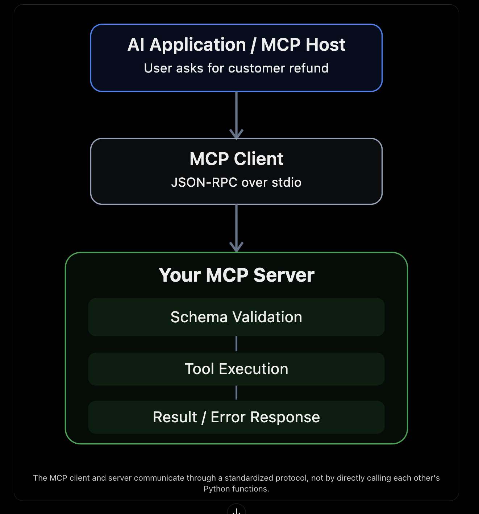

# Understanding Task 1: Build a Custom MCP Server with Strict Validation & Transport Handling

## 1. What you're building

**Example scenario.** A customer says:

> "I purchased something last week. Can you check my customer record and refund $25 because the product arrived damaged?"

The AI model cannot directly access your company's customer database or payment system. It needs a secure, standardized way to request those operations. That's where MCP comes in.

### 1.1 What is MCP?

MCP stands for **Model Context Protocol**. It is a protocol that lets AI applications discover and interact with external tools and data sources.

### 1.2 How does an MCP server work?



### 1.3 MCP tools

| Tool                  | Responsibility                                     |
| --------------------- | -------------------------------------------------- |
| `get_customer_record` | Look up customer information using an ID           |
| `trigger_refund`      | Process a refund request for a specified customer  |

For this exercise, the database and refund system are simulated with in-memory data.

## 2. What happens when the AI calls a tool?

Suppose the AI decides to retrieve customer `CUST-12345`. The sequence is:

1. The MCP client starts your server as a separate process.
2. The client and server initialize an MCP session (`initialize` handshake).
3. The client requests the list of available tools using `tools/list`.
4. The server returns the tool names and input schemas.
5. The AI application selects `get_customer_record`.
6. The MCP client sends a `tools/call` JSON-RPC request.
7. The server validates the input, executes the tool, and returns a result.
8. The AI application uses that result to respond to the user.

## 3. MCP vs JSON-RPC vs stdio

These three concepts serve different purposes.

| Concept      | Meaning                 | Responsibility                                        |
| ------------ | ----------------------- | ----------------------------------------------------- |
| MCP          | Model Context Protocol  | Defines tools, discovery, lifecycle, and interactions |
| JSON-RPC 2.0 | Message protocol        | Defines request, response, error structure, and IDs   |
| stdio        | Communication transport | Moves messages through process input/output streams   |

Think of it like this:

- **MCP:** What operations are available?
- **JSON-RPC:** How do we represent a request or response?
- **stdio:** How do we deliver that message to the server?

### 3.1 Important: let the SDK own stdout

You should not manually print JSON-RPC responses when using the official SDK. It already handles serialization and transport framing.

## 4. stdout vs stderr: the logging rule

With the stdio transport, the client reads **every line on stdout as a JSON-RPC message**. Any extra text corrupts the stream:

```text
{"jsonrpc":"2.0","id":1,"result":{...}}
processing refund...        <- client fails to parse this line
```

Rules:

- **stdout** is reserved for JSON-RPC messages written by the SDK.
- **stderr** receives all logs, debug output, and errors.
- Never use `print()`: it writes to stdout by default.
- Use Python's `logging` module, configured to write to `sys.stderr`.

## 5. Input validation requirements

Your server must reject bad input **before** performing any operation.

### 5.1 Tool 1: `get_customer_record`

Input:

```json
{ "customer_id": "CUST-12345" }
```

The requirement says the ID must follow `CUST-XXXXX`. We interpret that as exactly five digits after `CUST-`:

```regex
^CUST-[0-9]{5}$
```

| Part     | Meaning               |
| -------- | --------------------- |
| `^`      | Beginning of string   |
| `CUST-`  | Exact required prefix |
| `[0-9]`  | A digit from 0 to 9   |
| `{5}`    | Exactly five digits   |
| `$`      | End of string         |

### 5.2 Tool 2: `trigger_refund`

Input:

```json
{
  "customer_id": "CUST-12345",
  "amount": 25.0,
  "reason": "Product arrived damaged"
}
```

There are three independent validations:

| Field         | Rule                                                                                                  |
| ------------- | ----------------------------------------------------------------------------------------------------- |
| `customer_id` | Must match the same ID format.                                                                        |
| `amount`      | Must be a positive, finite number. Integers like `25` are accepted; booleans, strings, `NaN`, and `Infinity` are rejected. Maximum 2 decimal places (money). |
| `reason`      | Must be a string with at least 10 characters **after trimming whitespace** (10 spaces do not count). |

### 5.3 Why strict validation matters

Without strict validation, a caller might send:

```json
{
  "customer_id": "CUST-12345",
  "amount": "25",
  "reason": "Product arrived damaged"
}
```

A permissive system might convert `"25"` into a number automatically. Strict validation means the server rejects a string when it expects a number.

It also needs to reject unexpected properties:

```json
{
  "customer_id": "CUST-12345",
  "amount": 25,
  "reason": "Product arrived damaged",
  "admin_override": true
}
```

The `admin_override` property was never defined in the tool schema. For this exercise, rejecting it is safer than silently ignoring it.

## 6. JSON-RPC error codes

JSON-RPC defines standard error codes:

| Code     | Meaning          | Example                             | Produced by    |
| -------- | ---------------- | ----------------------------------- | -------------- |
| `-32700` | Parse error      | Malformed JSON                      | SDK            |
| `-32600` | Invalid request  | Missing required JSON-RPC structure | SDK            |
| `-32601` | Method not found | Unsupported JSON-RPC method         | SDK            |
| `-32602` | Invalid params   | Bad tool arguments or unknown tool  | **Our server** |
| `-32603` | Internal error   | Unexpected server failure           | **Our server** |

### 6.1 An important MCP distinction

There are two different ways an MCP tool can fail.

**Protocol error:** something is wrong with the request itself, such as an unknown tool or invalid arguments. It is returned as a JSON-RPC `error` object:

```json
{
  "jsonrpc": "2.0",
  "id": 3,
  "error": {
    "code": -32602,
    "message": "Invalid params",
    "data": [{ "field": "amount", "issue": "must be greater than 0" }]
  }
}
```

**Tool execution error:** the call was valid and understood, but the operation failed, for example because the customer does not exist or the refund exceeds the available balance. It is returned as a normal `result` with `isError: true`:

```json
{
  "jsonrpc": "2.0",
  "id": 4,
  "result": {
    "isError": true,
    "content": [{ "type": "text", "text": "Customer CUST-99999 not found" }]
  }
}
```

### 6.2 Design note: spec vs task requirement

> Recent MCP spec revisions recommend returning input validation failures as tool execution errors (`isError: true`) so the model can read the message and self-correct. This task explicitly requires standard JSON-RPC error codes, so this server returns `-32602` for invalid input. This is a deliberate, documented trade-off.

## 7. How to test the server

Don't test this by typing random JSON directly into the running server and assuming it works. MCP requires a proper initialization handshake and message exchange.

The easiest manual approach is the **MCP Inspector**. It lets you connect to your stdio server, discover its tools, submit arguments, and inspect responses.

### 7.1 What to test

| Test                | Input                        | Expected                                |
| ------------------- | ---------------------------- | --------------------------------------- |
| Valid customer      | `CUST-12345`                 | Customer returned                       |
| Invalid prefix      | `USER-12345`                 | JSON-RPC error `-32602`                 |
| Too few digits      | `CUST-1234`                  | JSON-RPC error `-32602`                 |
| Wrong type          | `12345` (number)             | JSON-RPC error `-32602`                 |
| Missing ID          | no `customer_id`             | JSON-RPC error `-32602`                 |
| Negative refund     | `-20`                        | JSON-RPC error `-32602`                 |
| Zero refund         | `0`                          | JSON-RPC error `-32602`                 |
| String amount       | `"25"`                       | JSON-RPC error `-32602`                 |
| Too many decimals   | `10.999`                     | JSON-RPC error `-32602`                 |
| Short reason        | `"broken"`                   | JSON-RPC error `-32602`                 |
| Whitespace reason   | `"            "`             | JSON-RPC error `-32602`                 |
| Extra field         | `admin_override: true`       | JSON-RPC error `-32602`                 |
| Unknown tool        | `name: "delete_customer"`    | JSON-RPC error `-32602`                 |
| Unknown customer    | `CUST-99999`                 | Result with `isError: true` (not found) |

You should also test `NaN`, `Infinity`, booleans, `null`, and unexpected nested objects.

## 8. How to verify stdout isolation

This is one of the most important parts of the challenge.

1. **Client-level integration test:** start the real server as a subprocess and talk to it through the official MCP client. This proves a real client can initialize a session, discover tools, and execute calls.
2. **Raw transport test:** the client test does not prove that every byte on stdout is valid JSON-RPC. Add a lower-level subprocess test that captures stdout and stderr separately, performs the initialization handshake, and parses **every stdout line** as JSON-RPC. It should also confirm that log output appears on stderr only.

A good test suite verifies both protocol behavior and raw transport cleanliness.
