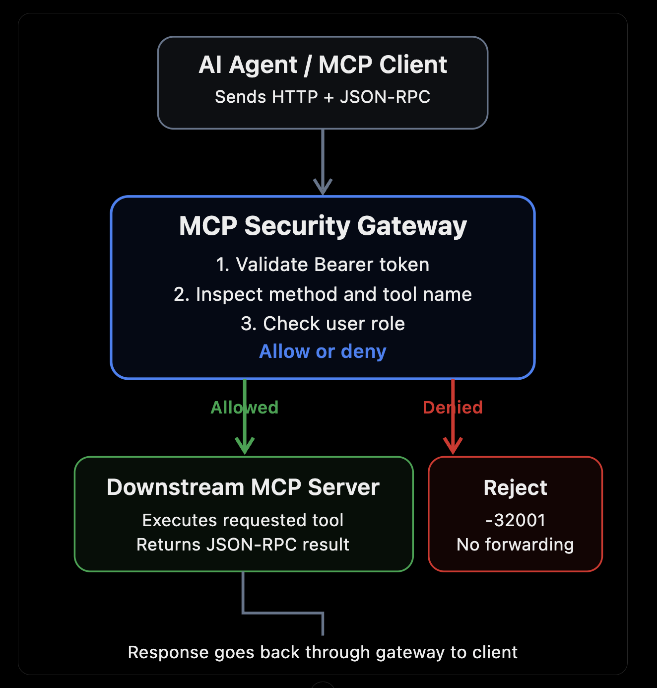

# Task 2: Build an MCP Security Gateway Proxy — Explained from Scratch

You are building a middle layer that checks whether an AI agent is allowed to execute a particular tool **before** the request reaches the MCP server.

## 1. The real-world problem

Employees can ask the AI assistant things like:

- "Show me all customer records."
- "Get the details for customer CUST-12345."
- "Reset the company's API key."
- "Delete all customer records."

The AI assistant has access to tools provided by an MCP server. For example:

| MCP tool                | What it does                   | Who should use it? |
| ----------------------- | ------------------------------ | ------------------ |
| `get_customer`          | Retrieves customer information | Everyone           |
| `list_orders`           | Lists orders                   | Everyone           |
| `admin_reset_key`       | Resets an API key              | Admin only         |
| `admin_delete_customer` | Deletes customer data          | Admin only         |

Now imagine two users:

- **Alice** is an **admin**. She should be able to execute all four tools.
- **Bob** is a **viewer**. He should only be allowed to retrieve information, not reset keys or delete records.

Here's the problem: what if Bob asks the AI assistant to reset an API key, and the AI tries to call `admin_reset_key`?

You don't want to depend on the AI remembering the security rules. Even if the AI makes a mistake, the request must be blocked.

That's why we build an **MCP Security Gateway**.

## 2. The architecture



### 2.1 The three main components

| Component | Role |
| --------- | ---- |
| **1. AI Agent / MCP Client** | The application that wants to execute a tool. It sends an HTTP request containing a JSON-RPC message and an authorization token. |
| **2. MCP Security Gateway** *(the assignment)* | The service we build. It receives the request first, verifies who the user is, checks which tool they're calling, and decides whether to forward or reject it. |
| **3. Downstream MCP Server** | The server that provides and executes tools. For this assignment it's a mock server that simulates behaviour instead of connecting to a real database. |

> **Key idea:** the gateway makes the authorization decision; the downstream server performs the actual work.

## 3. What is HTTP/JSON-RPC?

The task says: *"Build a lightweight HTTP/JSON-RPC reverse proxy."* This combines two different concepts.

### 3.1 HTTP is how the message travels

```http
POST /mcp HTTP/1.1
Host: localhost:8000
Authorization: Bearer viewer-token-bob
Content-Type: application/json
```

- The **`Authorization` header** tells the gateway which credentials the caller is presenting.
- The **HTTP body** contains the actual MCP request.

### 3.2 JSON-RPC is the structure of the message

```json
{
  "jsonrpc": "2.0",
  "id": 1,
  "method": "tools/call",
  "params": {
    "name": "admin_reset_key",
    "arguments": {
      "key_id": "KEY-123"
    }
  }
}
```

| Field              | Meaning                                       |
| ------------------ | --------------------------------------------- |
| `jsonrpc`          | Protocol version, always `"2.0"`              |
| `id`               | Request identifier used to match the response |
| `method`           | The operation being requested                 |
| `params`           | Parameters for that operation                 |
| `params.name`      | The specific MCP tool to execute              |
| `params.arguments` | Input values passed to that tool              |

### 3.3 An important distinction

- `tools/call` is **not** the name of the tool. It is an MCP protocol **method** that tells the server to execute a tool.
- `admin_reset_key` is the actual **tool name**.

The gateway must inspect **both**.

## 4. How the gateway decides

Every `POST /mcp` request goes through the same four steps, in this order:

| Step | What happens | On failure |
| ---- | ------------ | ---------- |
| 1. **Authenticate** | Read `Authorization: Bearer <token>` and look up the user and role | `401`, `-32000` |
| 2. **Parse** | Check the body is one valid JSON-RPC message | `400`, `-32700` / `-32600` |
| 3. **Authorize** | If `method` is `tools/call` and `params.name` starts with `admin_`, require the `admin` role | `403`, `-32001` Unauthorized Tool Call |
| 4. **Forward** | Send the request downstream and stream the response back | `502` / `504`, `-32002` |

Steps 1–3 reject the request **without ever contacting the downstream server**.

- `tools/list` → forwarded transparently for every authenticated user.
- `tools/call` → the tool name is checked before forwarding.

## 5. Error codes

| Code     | Meaning                        | Example                                    |
| -------- | ------------------------------ | ------------------------------------------ |
| `-32700` | Parse error                    | Body is not valid JSON                     |
| `-32600` | Invalid request                | Wrong `jsonrpc` version, batch, duplicate keys |
| `-32602` | Invalid params                 | `tools/call` without a tool name           |
| `-32000` | Unauthenticated (gateway)      | Missing or unknown token                   |
| `-32001` | **Unauthorized Tool Call**     | Viewer calls `admin_reset_key`             |
| `-32002` | Downstream unavailable (gateway) | Mock server is down or timed out         |

JSON-RPC reserves `-32000` to `-32099` for implementation-defined errors, which is where the gateway-specific codes live.

## 6. Bypass attempts the gateway must block

A security gateway is only as good as its edge cases:

| Attempt | Example | Why it's dangerous | Gateway response |
| ------- | ------- | ------------------ | ---------------- |
| Case change | `ADMIN_reset_key` | Downstream might match names case-insensitively | `403`, `-32001` |
| Leading whitespace | `" admin_reset_key"` | Downstream might trim the name | `403`, `-32001` |
| Batch smuggling | `[tools/list, admin_reset_key]` | Admin call hidden among allowed ones | `400`, `-32600` |
| Duplicate keys | `{"name": "get_customer", "name": "admin_reset_key"}` | Gateway and downstream may read different values | `400`, `-32600` |

The gateway also **never forwards the client's token**. The downstream server receives the verified identity as `X-Gateway-User` and `X-Gateway-Role` headers instead.

## 7. How to test

| Test | Token | Request | Expected |
| ---- | ----- | ------- | -------- |
| Viewer lists tools | `viewer-token-bob` | `tools/list` | `200`, forwarded |
| Viewer calls a normal tool | `viewer-token-bob` | `get_customer` | `200`, forwarded |
| **Viewer calls an admin tool** | `viewer-token-bob` | `admin_reset_key` | **`403`, `-32001`, not forwarded** |
| Admin calls an admin tool | `admin-token-alice` | `admin_reset_key` | `200`, forwarded |
| No / fake token | — | `tools/list` | `401`, `-32000` |
| Downstream stopped | `viewer-token-bob` | `tools/list` | `502`, `-32002` |

**How to prove a request was not forwarded:** watch the mock server's log, or in automated tests check the list of messages the mock server recorded. Blocked requests must never appear there.
